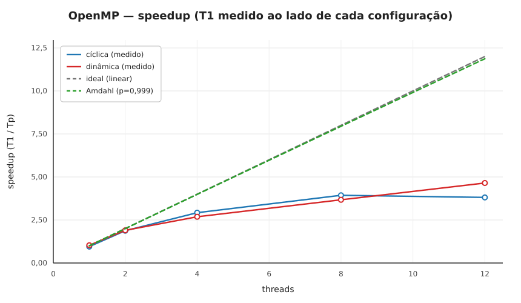
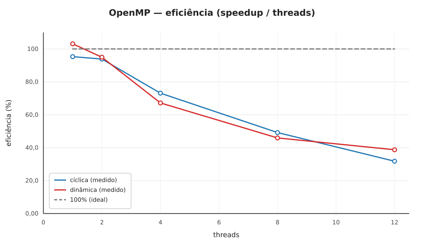
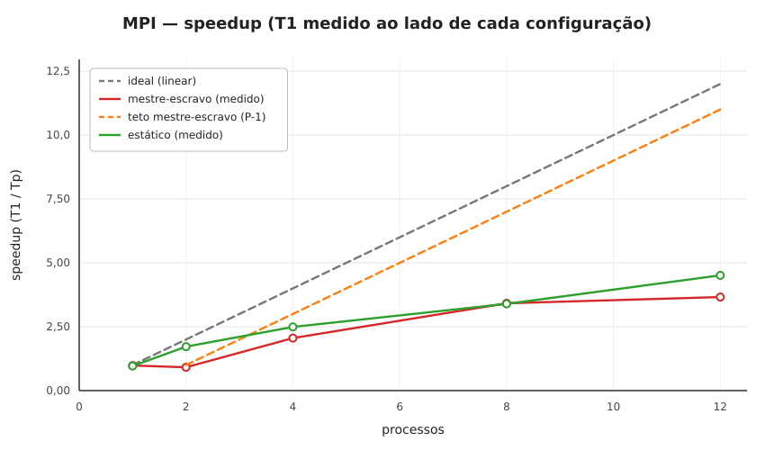
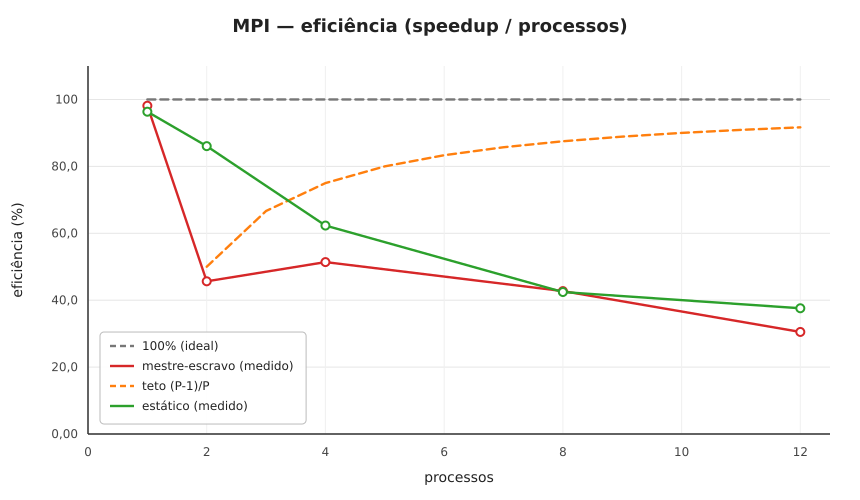
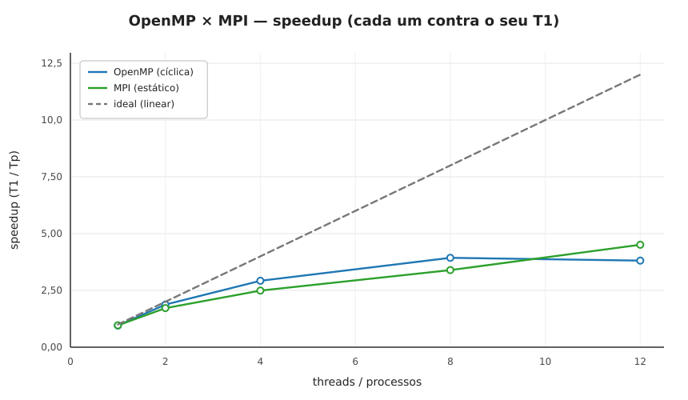
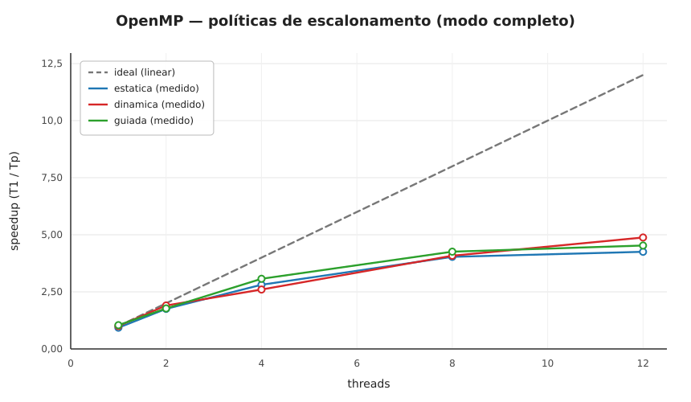
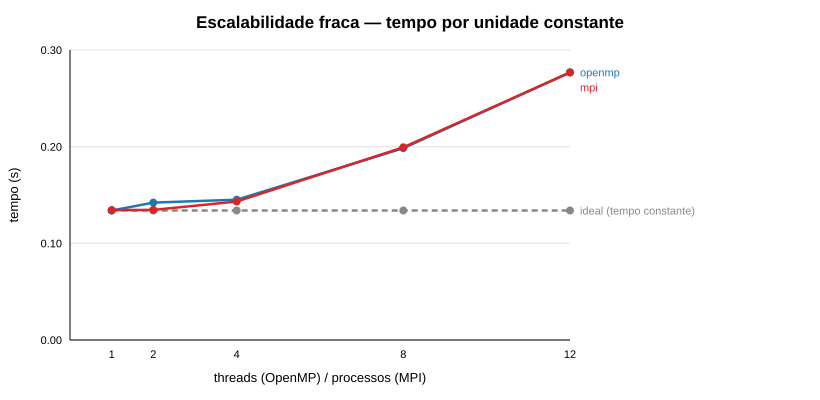

# Busca Exaustiva Paralela — Pré-imagem de Hash (Problema 9)

> **Disciplina:** Programação Paralela (CCO085) — 2026/2
> **Entrega:** Marco 2 — versão sequencial (baseline), versão OpenMP e versão MPI
> **Tema:** busca exaustiva de uma pré-imagem de hash, com término antecipado,
> decomposição de domínio/tarefas, operação coletiva, escalabilidade forte e
> fraca e discussão do afastamento em relação à Lei de Amdahl.
>
> **Estado do repositório:** código, scripts, dados e gráficos prontos.
> Ver [`docs/PLANO_MARCO2.md`](docs/PLANO_MARCO2.md) (plano de trabalho),
> [`docs/DECISAO_MPI_MODOS.md`](docs/DECISAO_MPI_MODOS.md) (por que existem dois
> modos de MPI) e [`docs/PENDENCIAS.md`](docs/PENDENCIAS.md) (o que ainda precisa
> ser preenchido pelo grupo).

---

## 1. Resumo executivo

O problema 9 pede a busca exaustiva de uma pré-imagem: dado um hash `alvo`,
encontrar a chave `k` tal que `h(k) == alvo`, varrendo o espaço de busca e
**parando na primeira ocorrência**. O baseline sequencial fornecido pelo
professor resolve isso em `O(ESPACO)`.

O que este projeto entrega:

| Item | Onde |
|---|---|
| Baseline sequencial **sem nenhuma alteração** (compilado direto de `docs/`) | `docs/baseline_sequencial.cpp` → `bin/sequencial` |
| Versão **OpenMP** (memória compartilhada) com término antecipado seguro, `atomic` + `critical` e `reduction(min:)` | `src/openmp/openmp.cpp` |
| Versão **MPI** (memória distribuída) com **dois modos**: mestre-escravo e estático | `src/mpi/mpi.cpp` |
| Prova de corretude (160 combinações comparadas com o baseline) | `scripts/validar.sh` |
| Coleta de medições em CSV (235 execuções) e agregação | `scripts/coletar.sh`, `dados/bruto.csv`, `dados/resultados.csv` |
| 8 gráficos (tempo, speedup, eficiência, políticas, forte e fraca) | `scripts/gerar_graficos.py`, `graficos/*.svg` |
| Análise crítica do afastamento em relação a Amdahl | seção 8 deste README |

**Resultado principal (medição real, seção 7):** com 12 threads a versão
OpenMP mede entre **3,8× e 4,7×** mais rápida que a mesma implementação com
1 thread (a diferença entre as duas políticas fica dentro do ruído de ±10% da
medição); com 12 processos, o modo MPI estático atinge **4,51×** e o
mestre-escravo **3,66×** — este último limitado estruturalmente por existir um
processo que não busca (teto `(P−1)/P`), como discutido na seção 8.

---

## 2. Análise do problema: o que realmente decide o projeto

### 2.1 O que o baseline faz

```c
alvo = h(ESPACO / 3);
for (uint64_t k = 0; k < ESPACO; k++)
    if (h(k) == alvo) { achou = k; break; }
```

* Complexidade `O(ESPACO)` no pior caso; com término antecipado, o trabalho
  efetivo é `ESPACO/3` chaves.
* O laço do hash domina praticamente 100% do tempo: não há I/O, alocação nem
  estrutura de dados no caminho quente. A fração paralelizável é, portanto,
  praticamente 1 — a Lei de Amdahl prevê speedup próximo de `P`, e todo o
  desvio observado vem de custos **reais** (freqüência da CPU, SMT, criação
  de threads, granularidade da parada, coordenação em MPI).
* `h` é o finalizador do MurmurHash3 (`fmix64`), formado apenas por operações
  **invertíveis** (`x ^= x >> 33` e multiplicação por constantes ímpares módulo
  2^64). Logo `h` é **bijetora**: cada alvo tem **uma única** pré-imagem.

Consequência prática: **basta comparar a chave encontrada com a do baseline**
para provar corretude, em qualquer tamanho de espaço, número de threads ou
processos, e em qualquer política de escalonamento. É isso que
`scripts/validar.sh` faz (160/160 combinações OK, incluindo os casos de borda
`ESPACO = 0, 1, 2, 3`).

### 2.2 O ponto crítico: término antecipado × distribuição do trabalho

O trabalho **não é fixo**: o algoritmo para na primeira ocorrência. Isso tem
duas consequências que a maioria das implementações ignora:

1. **A distribuição importa mais que a contagem de threads.** Se cada thread
   receber um intervalo contíguo grande, a thread que contém `ESPACO/3` começa
   perto do alvo, as outras terminam cedo e ficam ociosas: o tempo (e o
   speedup) passa a depender da *posição da chave*, não da paralelização.
   Nesta implementação a distribuição principal é **cíclica em blocos pequenos**
   (bloco de 16 Ki chaves), de modo que todas as threads avançam "lado a lado"
   e param com diferença de no máximo um bloco.
2. **O trabalho total é `ESPACO/3`, e não `ESPACO`.** Comparar a versão
   paralela com o baseline exige que ambos parem no mesmo lugar — por isso as
   curvas principais usam o modo *antecipado* (idêntico ao baseline) e existe um
   modo `--completo` para medir **trabalho constante** (varrimento integral),
   onde o speedup é calculado contra a varredura completa de 1 thread.

### 2.3 Por que o `--completo` existe

Sem ele não é possível medir escalabilidade de forma limpa: com término
antecipado, o speedup depende de *quando* a chave aparece. O modo completo
(`--completo`) varre todo o espaço, usa `reduction(min:)` em OpenMP e
`MPI_Allreduce(MIN)` em MPI, e é usado para: (a) comparar políticas de
escalonamento; (b) medir o custo de MPI com trabalho idêntico em todos os
processos; (c) confirmar que a escalabilidade não depende do artifício da
parada.

---

## 3. Estrutura do projeto

```
.
├── Makefile                      compila, valida, coleta e plota
├── README.md                     este briefing
├── AUTORES.md                    integrantes e frentes (placeholders)
├── .gitignore
├── docs/
│   ├── baseline_sequencial.cpp   baseline ORIGINAL do professor (intocado)
│   ├── Projeto_Academico_PP_20262.pdf
│   ├── PLANO_MARCO2.md           plano de trabalho e critérios de aceite
│   ├── DECISAO_MPI_MODOS.md      por que existem dois modos de MPI
│   └── PENDENCIAS.md             lista de placeholders a preencher
├── src/
│   ├── comum/busca.hpp           hash, alvo, cronômetro, parsing, saída
│   ├── openmp/openmp.cpp         versão OpenMP
│   └── mpi/mpi.cpp               versão MPI (mestre-escravo e estático)
├── scripts/
│   ├── validar.sh                prova de corretude contra o baseline
│   ├── coletar.sh                gera dados/bruto.csv
│   ├── gerar_graficos.py         agrega os dados e gera os SVGs
│   └── configurar_ambiente.sh    instala o toolchain no WSL/laboratório
├── docker/Dockerfile             ambiente Linux reprodutível
├── dados/                        bruto.csv (por execução) e resultados.csv
└── graficos/                     SVGs usados neste README
```

**O baseline não foi alterado.** O `Makefile` compila `docs/baseline_sequencial.cpp`
direto, com as mesmas flags (`-O2`), sem cópia e sem edição. A lógica de
cálculo e a entrada de referência são, portanto, exatamente as do professor.

---

## 4. Como executar do zero

### 4.1 Com Docker (recomendado — é o caminho testado aqui)

```bash
docker build -t pp-busca -f docker/Dockerfile .

docker run --rm -it \
  -v "$(pwd)":/projeto -w /projeto \
  pp-busca bash

# dentro do container:
make            # compila as três versões em bin/
make validar    # 160 combinações comparadas com o baseline
make dados      # coleta as medições em dados/bruto.csv (~8 min)
make graficos   # gera dados/resultados.csv e graficos/*.svg
```

No Windows (PowerShell ou Git Bash), use `-v "C:/caminho/do/projeto":/projeto`.
O container já define `OMPI_ALLOW_RUN_AS_ROOT=1`, então o `mpirun` funciona
sem `--allow-run-as-root`.

### 4.2 Nativo (Linux/WSL com toolchain instalado)

```bash
sudo apt install -y build-essential openmpi-bin libopenmpi-dev python3
# ou: bash scripts/configurar_ambiente.sh

make && make validar && make dados && make graficos
```

### 4.3 Comandos úteis

```bash
./bin/sequencial 60000000                       # baseline (como no enunciado)
./bin/openmp 60000000 --threads=8               # OpenMP, 8 threads
./bin/openmp 60000000 --threads=8 --politica=dinamica
./bin/openmp 60000000 --completo --politica=estatica   # varredura completa
mpirun --use-hwthread-cpus -np 8 ./bin/mpi 60000000 --modo=mestre-escravo
mpirun --use-hwthread-cpus -np 8 ./bin/mpi 60000000 --modo=estatico
./bin/openmp --ajuda                            # todas as opções
```

Opções relevantes:

| Opção | Significado |
|---|---|
| `ESPACO` (1º argumento) | tamanho do espaço de busca (padrão `60000000`), igual ao baseline |
| `--threads=N` | número de threads (OpenMP) |
| `--politica=ciclica\|estatica\|dinamica\|guiada` | política de escalonamento |
| `--modo=mestre-escravo\|estatico` | decomposição do MPI |
| `--completo` | varre todo o espaço em vez de parar no 1º acerto |
| `--bloco=N` | chaves por bloco (OpenMP) / bloco mínimo (MPI mestre-escravo) |
| `--intervalo=N` | chaves entre checagens de parada (MPI estático) |

> **`--use-hwthread-cpus`:** os scripts chamam o MPI com essa flag para que
> `-np 12` possa usar 12 *threads* lógicas (por padrão, o OpenMPI reserva
> apenas os núcleos físicos). Em máquinas sem SMT a flag é inofensiva. Se o
> laboratório usar MPICH ou outra implementação, sobrescreva o comando:
> `MPIRUN="mpirun" make dados` (ou `MPIRUN="mpirun --oversubscribe"`).
> O mesmo vale para `REPETICOES`, `REPETICOES_AUX`, `TAMANHO_FORTE`,
> `TAMANHO_COMPLETO`, `TAMANHOS_BASELINE`, `BASE_FRACA`, `THREADS` e
> `PROCESSOS` — todos opcionais, com padrões no próprio script.

### 4.4 Onde os dados e gráficos estão

| Arquivo | Conteúdo |
|---|---|
| `dados/bruto.csv` | **uma linha por execução** (235 linhas): versão, política, modo, escala, espaço, alvo, chave, threads, processos, tempos, mensagens, execução e a referência pareada |
| `dados/resultados.csv` | **uma linha por configuração** (63 linhas): mediana, mínimo, média, máximo, speedup, referência, mensagens e tempo de coletivas |
| `graficos/*.svg` | os 8 gráficos usados abaixo (SVG puro, sem dependências) |

---

## 5. Metodologia de medição

### 5.1 Máquina e toolchain

| Item | Valor |
|---|---|
| CPU | Intel Core i5-1235U (Alder Lake, notebook 15 W) — 12 CPUs lógicas / 6 núcleos físicos expostos pelo WSL2 + Docker Desktop |
| SO | Ubuntu 24.04 em container (kernel WSL2) |
| Compilador | g++ 13.3.0, flags `-O2 -std=c++17 -Wall -Wextra` (idênticas nas três versões) |
| MPI | Open MPI 4.1.x (`mpicxx`) |
| Gráficos | Python 3.12, **somente biblioteca padrão** (SVG gerado à mão, sem matplotlib) |

As três versões são compiladas com **as mesmas flags** e o mesmo código de hash,
de modo que a comparação entre elas seja justa. Não usamos `-march=native`
para que os binários continuem válidos em outras máquinas.

### 5.2 Protocolo

1. **Aquecimento global** (6 execuções do baseline) antes de qualquer medição,
   para a CPU sair do regime de boost frio e estabilizar.
2. **Descarte de warm-up**: 1 execução de aquecimento por configuração.
3. **Repetições**: 5 nas curvas principais, 3 nas auxiliares. Estatística
   reportada: **mediana** (e também mínimo, média e máximo no CSV).
4. **Referência pareada** — o ponto mais importante do protocolo:
   em vez de medir o T1 uma vez e comparar com medições feitas minutos depois,
   **cada execução é precedida da medição da referência** (a mesma versão com
   1 thread / 1 processo, mesmo espaço de busca). O speedup é a razão
   `ref/tempo` **dentro da mesma janela de tempo**.
   *Motivo:* em notebook, a frequência da CPU varia com temperatura e com o
   plano de energia do sistema — o mesmo código chegou a medir 1,28 s e 2,29 s
   em dois momentos do dia. Medir o T1 "longe" do Tp produz speedup falso.
   Esse protocolo elimina o viés e é o motivo de o speedup medido em T=1
   ficar entre 0,95 e 1,03 (e não exatamente 1,00).
5. **Tempo comparado**: `tempo_busca` mede **apenas a região de busca** nas
   três versões (no baseline, o próprio campo `tempo`). `tempo_total` inclui
   inicialização, leitura de argumentos e impressão; `tempo_coletivas` registra
   o tempo gasto em `MPI_Bcast` + `MPI_Allreduce` + `MPI_Reduce`.
6. **Tamanhos**: `ESPACO = 4,8·10^9` nas curvas fortes (o sequencial fica perto
   de 1,3 s), `6·10^8` no estudo de políticas (varredura completa) e
   `ESPACO = 4,8·10^8 × P` na escalabilidade fraca (trabalho por unidade
   constante).

### 5.3 Como os gráficos são gerados

`scripts/gerar_graficos.py` lê `dados/bruto.csv`, agrega por configuração,
escreve `dados/resultados.csv` e desenha os SVGs **sem nenhuma biblioteca
externa** (o SVG é escrito como texto). Isso é proposital: o projeto roda no
laboratório sem instalar nada além de `python3`.

---

## 6. Prova de corretude

`make validar` compara a chave de **todas** as versões com a do baseline em
8 tamanhos de espaço (incluindo `0, 1, 2, 3, 10, 1000, 100003, 60000000`),
várias políticas, 1/2/4/8/12 threads e `-np 1/2/4/8/12` nos dois modos de MPI:

```
ESPACO=60000000  (baseline: chave=20000000)
  openmp  ciclica  antecipado  threads=1                    OK   (chave=20000000)
  openmp  ciclica  antecipado  threads=12                   OK   (chave=20000000)
  openmp  dinamica antecipado  threads=12                   OK   (chave=20000000)
  openmp  estatica completo    threads=1                    OK   (chave=20000000)
  openmp  guiada   completo    threads=12                   OK   (chave=20000000)
  mpi     mestre-escravo antecipado  -np 12                 OK   (chave=20000000)
  mpi     estatico       antecipado  -np 12                 OK   (chave=20000000)
  ...
RESULTADO: 160/160 combinações OK — todas as versões reproduzem o baseline.
```

Além da chave, o CSV registra o `alvo` (`hash(ESPACO/3)`) de cada execução:
como o hash é bijetor, `chave == ESPACO/3` é a única resposta possível, e ela
é obtida em **todas** as configurações medidas (235 execuções de coleta
também conferidas).

---

## 7. Resultados medidos

> Valores = mediana das repetições; `ESPACO = 4,8·10^9` (1,6·10^9 chaves
> varridas com o término antecipado). Speedup = `T1/Tp`, com o `T1` medido ao
> lado de cada configuração (ver 5.2).

### 7.1 Baseline sequencial (arquivo original do professor)

| ESPACO | chaves varridas | tempo (s) | chave encontrada |
|---:|---:|---:|---:|
| 60.000.000 | 20.000.000 | 0,016172 | 20.000.000 |
| 480.000.000 | 160.000.000 | 0,130866 | 160.000.000 |
| 4.800.000.000 | 1.600.000.000 | 1,428943 | 1.600.000.000 |

O tempo é linear em `ESPACO` (0,016 s → 0,131 s → 1,429 s para 1× → 8× → 80×
o espaço), confirmando `O(ESPACO)`.

### 7.2 OpenMP — escalabilidade forte (término antecipado)

| threads | cíclica (s) | speedup | eficiência | dinâmica (s) | speedup | eficiência |
|---:|---:|---:|---:|---:|---:|---:|
| 1 | 1,411884 | 0,95 | 95,3% | 1,327071 | 1,03 | 103,1% |
| 2 | 0,781974 | **1,88** | 93,8% | 0,713358 | **1,90** | 95,0% |
| 4 | 0,551963 | **2,92** | 73,1% | 0,515466 | **2,69** | 67,2% |
| 8 | 0,368534 | **3,93** | 49,2% | 0,361506 | **3,67** | 45,9% |
| 12 | 0,349761 | **3,81** | 31,8% | 0,305086 | **4,65** | 38,7% |

> As duas políticas devem ser equivalentes neste problema (custo por chave
> uniforme). A diferença entre elas com 12 threads (3,81× contra 4,65×) está
> **dentro do ruído de ±10%** da medição — e é justamente por isso que o
> protocolo mede a referência ao lado de cada execução (seção 5.2). Com 2 e 4
> threads as duas curvas praticamente se sobrepõem.





### 7.3 MPI — escalabilidade forte (término antecipado)

| processos | mestre-escravo (s) | speedup | estático (s) | speedup | mensagens (mestre-escravo) |
|---:|---:|---:|---:|---:|---:|
| 1 | 1,338797 | 0,98 | 1,380409 | 0,96 | 0 |
| 2 | 1,527498 | **0,91** | 0,803909 | **1,72** | 174 |
| 4 | 0,642159 | **2,06** | 0,659808 | **2,49** | 520 |
| 8 | 0,396791 | **3,42** | 0,390821 | **3,39** | 1.224 |
| 12 | 0,351959 | **3,66** | 0,299361 | **4,51** | 1.908 |







### 7.4 OpenMP — políticas de escalonamento (modo completo, trabalho constante)

ESPACO = 6·10^8 (600 milhões de chaves varridas por todas as threads).

| threads | estática (s) | speedup | dinâmica (s) | speedup | guiada (s) | speedup |
|---:|---:|---:|---:|---:|---:|---:|
| 1 | 0,768215 | 0,93 | 0,730333 | 1,00 | 0,722074 | 1,04 |
| 2 | 0,429039 | 1,76 | 0,409776 | 1,90 | 0,414583 | 1,77 |
| 4 | 0,265557 | 2,81 | 0,281718 | 2,60 | 0,246984 | 3,07 |
| 8 | 0,182721 | 4,03 | 0,177739 | 4,08 | 0,179273 | 4,26 |
| 12 | 0,180562 | 4,26 | 0,157172 | 4,88 | 0,159706 | 4,53 |



Com trabalho **constante** e custo de escalonamento desprezível, `estática`
e `dinâmica` praticamente se empatam — como esperado, pois o custo por chave é
uniforme. `guiada` fica no meio: os blocos iniciais grandes concentram o
trabalho no começo, mas todos os blocos têm o mesmo tamanho no fim, então o
desbalanceamento aparece só no fim da execução. As três políticas convergem
para ~4,3×–4,9× com 12 threads: o que limita a curva não é a política, e sim
a máquina (seção 8.4).

### 7.5 MPI — modo completo (trabalho constante)

| processos | mestre-escravo (s) | speedup | estático (s) | speedup |
|---:|---:|---:|---:|---:|
| 1 | 0,500627 | 1,08 | 0,524693 | 1,05 |
| 4 | 0,323153 | 1,59 | 0,205516 | 2,63 |
| 12 | 0,141513 | **3,65** | 0,114931 | **4,86** |

O modo completo evidencia o custo do mestre: com 12 processos o
mestre-escravo rende 3,65× (e apenas 1,59× com 4 processos), enquanto o
estático chega a 4,86×.

### 7.6 Escalabilidade fraca (trabalho por unidade constante)

ESPACO = 4,8·10^8 × P (cada thread/processo recebe sempre a mesma fatia de
trabalho). Se a máquina escalasse sem perdas, o tempo seria **constante**.

| P | OpenMP (s) | MPI estático (s) | MPI mestre-escravo (s) |
|---:|---:|---:|---:|
| 1 | 0,130233 | 0,131406 | 0,184256 |
| 2 | 0,139908 | 0,188855 | 0,154069 |
| 4 | 0,229707 | 0,275959 | 0,277221 |
| 8 | 0,286788 | 0,282823 | 0,273292 |
| 12 | 0,393799 | 0,332616 | 0,360984 |



O tempo **cresce** em vez de ficar constante: mesmo com trabalho idêntico por
thread, cada thread executa mais devagar quando há mais threads ativas. A
razão é o **hardware desta máquina** (seção 8.4), não a algoritmo — é o
fenômeno clássico de queda de frequência (e de compartilhamento de recursos
entre hyper-threads) em processadores com limite de potência.

---

## 8. Discussão: por que as curvas não são lineares

A linha ideal (`speedup = P`) aparece tracejada em todos os gráficos. Ela
**nunca** é alcançada, e a Lei de Amdahl explica apenas parte do desvio.
Listamos as causas, da mais estrutural para a mais concreta.

### 8.1 O modo mestre-escravo tem um teto de `(P−1)/P` (causa estrutural)

Com `P` processos, **um deles é o mestre e não busca**. O melhor caso é:

```
T(P) ≈ T(1) / (P − 1)   ⇒   speedup ≈ P − 1   ⇒   eficiência ≈ (P − 1)/P
```

| P | 2 | 4 | 8 | 12 |
|---|---|---|---|---|
| teto do speedup | 1× | 3× | 7× | 11× |
| teto da eficiência | 50% | 75% | 87,5% | 91,7% |

Isso **não é defeito de implementação**: é a propriedade da decomposição
escolhida. A linha laranja tracejada do gráfico de MPI mostra esse teto, e o
modo estático (que usa todos os processos) é o contraponto experimental. É
justamente esse contraste que dá sentido à discussão pedida no enunciado.

O caso `P = 2` merece destaque: com **um único escravo**, o mestre-escravo
fica **mais lento** que o sequencial (0,91×). Não há erro — o escravo faz
todo o trabalho, o mestre ocupa um núcleo sem buscar, e ainda existe o custo
de coordenação (174 mensagens). É o exemplo mais claro de que "paralelizar" não
é automaticamente "acelerar": a decomposição precisa ser coerente com o
problema.

### 8.2 Coordenação e comunicação em MPI

O número de mensagens cresce com `P` (174 → 1.908) porque o mestre-escravo
entrega blocos de ~3,4 milhões de chaves: para varrer 1,6·10^9 chaves são
necessários ~43 blocos por escravo, e cada bloco gera um par pedido/resposta.
O tempo gasto em operações coletivas (`MPI_Bcast` + `MPI_Allreduce` +
`MPI_Reduce`) é de 0,07 ms com P=2 e chega a ~13 ms com P=4 e P=12 — **≈3% do
tempo total** no pior caso: irrelevante para a resposta, mas é o custo que
cresce com P.

O modo estático quase não comunica (22 mensagens: só o aviso de parada),
por isso escala melhor.

### 8.3 Granularidade do término antecipado

No modo antecipado, o trabalho por thread para no bloco que contém a chave.
Com blocos de 16 Ki chaves (OpenMP) ou 65 Ki chaves (MPI estático), o
desperdício é de no máximo um bloco por thread: abaixo de 0,1% do trabalho
total. Já uma distribuição **contígua** (um intervalo grande por thread)
faria o tempo depender da posição da chave — por isso `estatica` e `guiada`
são restritas ao modo `--completo` na versão OpenMP, e o modo MPI estático
usa **distribuição cíclica em blocos** (não contígua).

### 8.4 O hardware: SMT, núcleos híbridos e limite de potência

Esta é a maior causa de desvio **neste** ambiente. O notebook tem TDP de 15 W
e CPU híbrida (núcleos *performance* + *efficiency*); com 12 threads ativas o
processador reduz a frequência para caber no orçamento de potência, e os
hyper-threads de um mesmo núcleo físico compartilham as unidades de execução.
Efeitos observados:

* A eficiência cai de ~94% (2 threads) para ~32%–39% (12 threads) mesmo com
  trabalho proporcionalmente menor por thread.
* Na escalabilidade fraca, o tempo cresce 3× (OpenMP: 0,13 s → 0,39 s) mesmo
  com trabalho por thread constante (seção 7.6) — assinatura clara de queda
  de frequência.
* A mesma configuração chegou a medir 1,28 s e 2,29 s em janelas diferentes do
  dia, o que motivou o protocolo de referência pareada (5.2).

Em um desktop/servidor do laboratório, com núcleos homogêneos e TDP maior, as
curtas devem se aproximar bastante mais da reta ideal. **Os gráficos e o CSV
podem ser regenerados em uma única máquina** com `make dados && make graficos`
— é exatamente por isso que o projeto entrega scripts, e não só números.

### 8.5 Law of Amdahl

A Lei de Amdahl diz que, com fração serial `f` e paralela `1−f`:

```
S(P) = 1 / ( f + (1 − f)/P )
```

O laço do hash é ~100% paralelizável (`f ≈ 0`), então Amdahl **não** explica a
queda observada: com `p = 0,999` a curva previsto ficaria em 11,8× com
P=12 (trace verde no gráfico de OpenMP), contra 3,8×–4,7× medidos. A distância
entre as duas curvas é o que **sobra** para os efeitos reais: frequência/SMT
(seção 8.4), criação de threads, granularidade da parada e coordenação MPI
(seção 8.2). Ou seja: **Amdahl é o teto teórico, e o que medimos é o teto
real** — o desvio do Amdahl para a curva medida é a informação mais
interessante do experimento, e é o que a Lei de Amdahl sozinha não captura.

### 8.6 Quadro-resumo das causas

| Causa | Tipo | Onde aparece |
|---|---|---|
| Mestre ocioso (`P−1` trabalhadores) | algorítmo | MPI mestre-escravo |
| Coordenação (1.904 mensagens, 12 ms de coletivas) | algorítmo | MPI mestre-escravo |
| Blocos de trabalho / término antecipado | algorítmo | OpenMP e MPI |
| Criação de threads e de processos | overhead | OpenMP e MPI |
| Queda de frequência / SMT / TDP | **hardware** | todas as curvas |
| Ruído de medição (±10%) | experimental | tratado por mediana + referência pareada |

---

## 9. Limitações e trabalhos futuros

* **Hardware.** As curvas foram medidas em notebook com TDP de 15 W; o
  gargalo é físico. Repetir em máquina homogênea muda o resultado (scripts
  prontos para isso).
* **Escalabilidade fraca** não é plana por causa da queda de frequência
  (8.4). Em máquina de laboratório, espera-se curva plana.
* **Modo mestre-escravo com mestre que também trabalha.** Poderia eliminar o
  teto `(P−1)/P` (mestre busca enquanto não há pedidos pendentes). Não foi
  implementado de propósito: o enunciado pede o padrão mestre-escravo, e a
  comparação entre os dois modos já responde à pergunta.
* **Novo tamanho de bloco** e **número de blocos por escravo** são parâmetros
  que merecem um estudo de sensibilidade (hoje: 128 blocos por escravo).
* **Balanceamento adaptativo**: com custo de chave uniforme, políticas
  dinâmicas não trazem ganho (7.4) — em problemas com custo variável, elas
 volta a compensar.

---

## 10. Perguntas prováveis na defesa

**P. Por que a chave encontrada é sempre `ESPACO/3`?**
Porque `h` é o finalizador do MurmurHash3, formado por operações invertíveis
(`x ^= x >> 33` e multiplicação por ímpares módulo 2^64): é bijetor. Logo
existe uma única pré-imagem de `alvo = h(ESPACO/3)`, que é `ESPACO/3`.

**P. Como vocês garantem que a parada antecipada não "pula" a resposta?**
A busca é exaustiva sobre blocos: com a distribuição cíclica em blocos
pequenos, todos os blocos anteriores ao bloco da chave já foram processados
por alguém antes da parada. E, de qualquer forma, como o hash é bijetor,
qualquer achado é o achado único.

**P. Qual a condição de corrida e como ela foi tratada?**
A flag `parar` (escrita por uma thread, lida por todas) é um `std::atomic<bool>`
com `memory_order_relaxed`, lida a cada 1024 chaves — assim o caminho quente não
gera tráfego de coerência de cache. A fusão do resultado local no global é
feita uma única vez por thread dentro de `#pragma omp critical` (O(T) operações,
não O(ESPACO)). No modo completo, sem parada, o papel é da `reduction(min:)`.

**P. Por que `estatica`/`guiada` só podem ser usadas no modo completo?**
Porque, com término antecipado, um bloco contíguo grande por thread faz o
tempo depender da posição da chave: threads abandonam trechos ainda não
verificados e a medição deixa de ser uma comparação justa. Como o hash é
bijetor o resultado continuaria correto, mas a *medição* não seria.

**P. Qual a diferença entre os dois modos de MPI?**
`mestre-escravo`: distribuição de tarefas sob demanda, um processo
coordenador (padrão do enunciado) — teto de eficiência `(P−1)/P`.
`estático`: decomposição de domínio em blocos cíclicos, todos os processos
buscam, término avisado por mensagem não bloqueante (`MPI_Iprobe`) — escala
melhor. A discussão está em [`docs/DECISAO_MPI_MODOS.md`](docs/DECISAO_MPI_MODOS.md).

**P. Que operações coletivas vocês usaram?**
`MPI_Bcast` (configuração: espaço, alvo, bloco, modo — o rank 0 é a única
fonte da verdade), `MPI_Allreduce(MPI_MIN)` (resultado final, garante que a
resposta independa da ordem de chegada das mensagens) e `MPI_Reduce(MPI_SUM)`
(contagem de mensagens para a análise de overhead).

**P. Por que o speedup é medido contra o T1 da própria implementação?**
Porque o T1 medido no mesmo instante elimina a variação de frequência da CPU,
e porque é a definição usada em speedup (`T1/Tp` com T1 do mesmo código).
O tempo do baseline do professor é reportado em todas as tabelas
(7.1) para comparação direta.

**P. Como vocês controlaram o ruído?**
Aquecimento global e por configuração, descarte do warm-up, 5 repetições,
mediana como estatística e — o mais importante — **referência pareada**: cada
execução é medida logo após uma execução da referência (T1) da mesma
configuração.

**P. O que é escalabilidade fraca e o que ela mostrou aqui?**
Escalabilidade fraca é manter constante o trabalho **por unidade de
paralelismo** e aumentar o total. O ideal é o tempo constante. Mediu-se
crescimento de 0,13 s (P=1) para 0,39 s (P=12) no OpenMP: como o trabalho por
thread era idêntico, o crescimento é atribuído à queda de frequência do
processador (8.4), e não ao algoritmo.

---

## 11. Reprodutibilidade

* Todo o material experimental está versionado: `dados/bruto.csv`,
  `dados/resultados.csv` e `graficos/*.svg`.
* Um comando reproduz tudo: `make validar && make dados && make graficos`.
* Sem dependências além de `g++`, `OpenMP`, `Open MPI` e `python3`
  (biblioteca padrão).
* Nenhum passo do trabalho foi enviado ao repositório remoto até o momento
  da revisão do grupo (ver seção de pendências).

---

## 12. Pendências antes da entrega

Consulte [`docs/PENDENCIAS.md`](docs/PENDENCIAS.md) e [`AUTORES.md`](AUTORES.md):
nome dos integrantes, turma, data e os números da máquina do laboratório
(trocar pelos medidos lá, se a apresentação for feita em outro equipamento).
