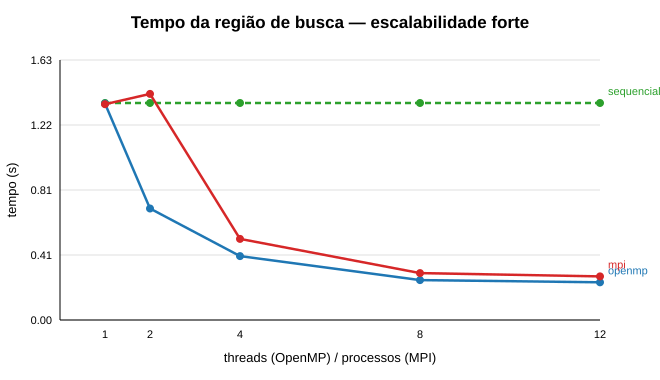
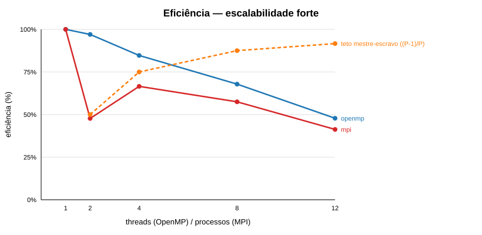

# Busca Exaustiva Paralela — Problema 9

> Programação Paralela (CCO085) — 2026/2 — Prof. Rodrigo Gonçalves
> Trabalho: paralelizar o baseline de força bruta fornecido pelo professor.
> Versões: **sequencial (intocada)**, **OpenMP** e **MPI (mestre-escravo)**.

> **Primeira vez com C++ ou paralelização?** Comece por
> [`docs/GUIA_INICIANTE.md`](docs/GUIA_INICIANTE.md): ele explica o projeto do
> comando digitado até a linha impressa, sem pular nada.

---

## 1. O problema

O baseline (`docs/baseline_sequencial.cpp`) faz o seguinte:

```c
alvo = h(ESPACO / 3);
for (k = 0; k < ESPACO; k++)
    if (h(k) == alvo) { achou = k; break; }
```

Ele procura a chave `k` cujo hash é igual ao alvo e **para no primeiro acerto**.
O hash é o finalizador do MurmurHash3: são sempre 3 XORs e 2 multiplicações,
independentemente de `k`. Duas consequências importantes:

1. **Custo por chave constante.** Não há carga desigual entre threads/processos.
   Por isso não comparamos `static`/`dynamic`/`guided`: o enunciado só pede esse
   estudo *quando o problema tiver carga desigual*.
2. **O hash é bijetor** (todas as operações são invertíveis). Existe uma única
   chave para cada alvo, e ela é `ESPACO/3`. Validar é simples: basta comparar
   a chave das versões paralelas com a do baseline.

O ponto delicado é o **término antecipado**: se um intervalo grande fosse dado
a cada thread, quem estivesse perto de `ESPACO/3` terminaria rápido e as demais
ficariam ociosas. Por isso dividimos o espaço em **blocos pequenos entregues
sob demanda** nas duas versões paralelas.

---

## 2. Como executar do zero

O ambiente de referência é Linux com `g++`, OpenMP e Open MPI. No Windows,
usamos o Docker (que é o caminho testado aqui):

```bash
docker build -t pp-busca -f docker/Dockerfile .
docker run --rm -it pp-busca bash
```

O `-v` não é mais necessário: o Dockerfile **copia o projeto para dentro da
imagem**, então `/projeto` já vem com os arquivos. Se ele aparecer vazio,
**reconstrua a imagem** com o `docker build` acima — imagens antigas não tinham
essa cópia.

Se você editar os arquivos no Windows e quiser ver as mudanças sem reconstruir
a imagem, monte a pasta atual como volume. Escolha o comando do seu terminal:

| Terminal | Comando |
|---|---|
| **Git Bash** (o usado neste projeto) | `MSYS_NO_PATHCONV=1 docker run --rm -it -v "$(pwd -W):/projeto" -w /projeto pp-busca bash` |
| **PowerShell** | `docker run --rm -it -v "${PWD}:/projeto" -w /projeto pp-busca bash` |
| **Prompt de Comando (CMD)** | `docker run --rm -it -v "%cd%:/projeto" -w /projeto pp-busca bash` |

> **Erros clássicos (foi o que aconteceu aqui):** usar `%cd%` no Git Bash — ele
> não expande e o Docker cria uma pasta vazia com esse nome — ou esquecer o
> `MSYS_NO_PATHCONV=1`, que faz o `/projeto` virar `C:/Program Files/Git/projeto`.

Já dentro do container:

```bash
make              # compila as três versões em bin/
make validar      # prova de corretude
make dados        # gera dados/bruto.csv e dados/perfilamento.csv
make graficos     # gera dados/resultados.csv e graficos/*.svg
```

Para demonstrar ao vivo, os comandos essenciais são:

```bash
./bin/sequencial 60000000
./bin/openmp 60000000 --threads=8
mpirun -np 8 ./bin/mpi 60000000
```

Os três imprimem a mesma chave (`20000000`). O `--use-hwthread-cpus` é usado
pelos scripts para permitir `-np` igual ao número de CPUs lógicas.

---

## 3. Estrutura

```
docs/baseline_sequencial.cpp   baseline original do professor (intocado)
docs/GUIA_INICIANTE.md         explicação passo a passo para iniciantes
src/comum/busca.hpp            hash, alvo, argumentos e saída padronizada
src/openmp/openmp.cpp          versão OpenMP
src/mpi/mpi.cpp                versão MPI (mestre-escravo)
scripts/validar.sh             compara as chaves com o baseline
scripts/coletar.sh             gera os CSVs de medição
scripts/gerar_graficos.py      agrega dados e desenha os SVGs
docker/Dockerfile              ambiente Linux com g++, OpenMPI e Python
dados/                         bruto.csv, resultados.csv, perfilamento.csv
graficos/                      tempo, speedup, eficiência e escalabilidade fraca
```

**O baseline não foi alterado.** O Makefile compila o arquivo original de
`docs/` diretamente, com as mesmas flags `-O2` das versões paralelas.

---

## 4. O que o professor pede × onde está

| Requisito do enunciado | Onde |
|---|---|
| Baseline + perfilamento + Amdahl | Seções 5 e 8; `dados/perfilamento.csv` |
| OpenMP com tratamento de corrida e curva de speedup | `src/openmp/openmp.cpp`; `graficos/speedup.svg` |
| MPI com decomposição, coletiva e curva de speedup | `src/mpi/mpi.cpp`; `docs/DECISAO_MPI.md` |
| Validação de corretude | `scripts/validar.sh` |
| Gráficos de tempo, speedup, eficiência, forte e fraca | `graficos/` |
| Escalabilidade fraca | Seção 7; `graficos/escalabilidade_fraca.svg` |
| Afastamento de Amdahl (comunicação, desbalanceamento, false sharing, banda) | Seção 8 |
| Makefile, CSV, README, gráficos, AUTORES.md | raiz do repositório |

---

## 5. Código comentado — decisões principais

### OpenMP (`src/openmp/openmp.cpp`)

* `#pragma omp parallel for schedule(dynamic, 1)` sobre **blocos de 16.384
  chaves**: cada bloco é entregue a uma thread livre, então todas avançam
  juntas e a parada antecipada desperdiça no máximo um bloco.
* `std::atomic<bool> parar`: uma thread escreve, todas leem. Sem `atomic`
  haveria **condição de corrida**. Foi escolhido `atomic` em vez de `critical`
  porque é apenas um booleano, lido no início de cada bloco.
* `#pragma omp critical` uma vez **por thread**, no final, para fundir o menor
  índice no resultado global. Crítico dentro do laço seria um gargalo.
* `reduction(min:)` foi descartada: ela exige que o laço sempre termine, e aqui
  saímos antes. Não há nenhum vetor compartilhado escrito, portanto **não há
  false sharing**.

### MPI (`src/mpi/mpi.cpp`)

* **Decomposição mestre-escravo** (o aspecto destacado no problema 9): o rank 0
  distribui blocos `[início, fim)` sob demanda; os escravos respondem `PEDIDO`
  ou `RESULTADO`; ao primeiro resultado o mestre envia `PARAR` a todos.
* **Coletivas**: `MPI_Bcast` espalha espaço/alvo/bloco e `MPI_Allreduce(MPI_MIN)`
  consolida a chave final. O `MIN` preserva a ideia de "primeira ocorrência"
  mesmo que as mensagens cheguem em outra ordem.
* Com `P` processos, apenas `P−1` buscam. Isso explica o teto de eficiência
  `(P−1)/P` discutido na seção 8. A decisão de usar apenas este padrão está em
  `docs/DECISAO_MPI.md`.

---

## 6. Metodologia e perfilamento

* Aquecimento: 3 execuções do baseline antes da coleta + 1 por configuração
  (descartada).
* Repetições: 5 por configuração; os gráficos usam a **mediana**.
* Tempo comparado: `tempo_busca`, que mede só a região de busca nas três
  versões. É diretamente comparável ao `tempo=` impresso pelo baseline.
* Speedup: `T1/Tp` da **mesma versão**, medido na mesma curva.
* Escalabilidade fraca: `ESPACO = base × threads` no OpenMP e
  `ESPACO = base × (processos−1)` no MPI, pois no mestre-escravo existe um
  processo que não busca. O ideal seria tempo constante.

O perfilamento foi feito **sem modificar o baseline**: medimos o tempo total
com `date +%s%N` e comparamos com o tempo do laço que o próprio baseline
imprime. Resultado (`dados/perfilamento.csv`):

| ESPACO | tempo total (s) | tempo do laço (s) | % no laço |
|---:|---:|---:|---:|
| 60.000.000 | 0,020413 | 0,016745 | 82,0 |
| 480.000.000 | 0,137794 | 0,133333 | 96,8 |
| 4.800.000.000 | 1,339528 | 1,346270 | ~100 |

Nos tamanhos maiores, praticamente 100% do tempo está no laço do hash (a
diferença de poucos milissegundos está dentro do ruído da medição), então a
**fração paralelizável é `p ≈ 1`**. Pela Lei de Amdahl:

```
S(P) = 1 / ((1-p) + p/P)  ≈  P      (com p ≈ 1)
```

Ou seja: a reta ideal `speedup = P` é o teto teórico; qualquer queda observada
vem de custos reais, discutidos na seção 8.

---

## 7. Resultados medidos

Valores = mediana de 5 execuções, retirados de `dados/resultados.csv`.

### Escalabilidade forte

| configuração | tempo (s) | speedup | eficiência |
|---|---:|---:|---:|
| sequencial | 1,356594 | 1,00 | — |
| OpenMP 1 thread | 1,352755 | 1,00 | 100,0% |
| OpenMP 2 threads | 0,697000 | 1,94 | 97,0% |
| OpenMP 4 threads | 0,399368 | 3,39 | 84,7% |
| OpenMP 8 threads | 0,249195 | 5,43 | 67,9% |
| OpenMP 12 threads | 0,235784 | 5,74 | 47,8% |
| MPI 1 processo | 1,348921 | 1,00 | 100,0% |
| MPI 2 processos | 1,413248 | 0,95 | 47,7% |
| MPI 4 processos | 0,506794 | 2,66 | 66,5% |
| MPI 8 processos | 0,293373 | 4,60 | 57,5% |
| MPI 12 processos | 0,272404 | 4,95 | 41,3% |

O MPI trocou **87 mensagens** com 2 processos, **259** com 4, **607** com 8 e
**945** com 12. Com 2 processos o mestre-escravo é mais lento que o sequencial
(0,95×): um processo fica só coordenando e ainda existe o custo das mensagens.
O teto teórico de eficiência com 12 processos é `11/12 ≈ 91,7%`; o valor medido
(41,3%) fica bem abaixo por causa do hardware/SMT e da latência da parada.






### Escalabilidade fraca

| unidades | OpenMP (s) | MPI (s) |
|---:|---:|---:|
| 1 | 0,133991 | 0,134367 |
| 2 | 0,142154 | 0,134607 |
| 4 | 0,145182 | 0,143270 |
| 8 | 0,198414 | 0,199313 |
| 12 | 0,276910 | 0,276691 |

O tempo cresce com o número de unidades mesmo mantendo o trabalho por unidade
constante. Como o algoritmo e o volume por unidade são os mesmos, a causa é o
hardware (queda de frequência e compartilhamento de núcleos físicos/SMT), não a
decomposição.


---

## 8. Por que a curva real se afasta de Amdahl

1. **Mestre ocioso (decomposição).** No MPI, um dos `P` processos só coordena.
   O melhor caso é `T(P) ≈ T(1)/(P−1)`, ou seja, `speedup ≈ P−1` e eficiência
   `(P−1)/P`. Não é defeito de código: é o custo do padrão pedido no enunciado.
2. **Overhead de comunicação.** Cada bloco gera um par `PEDIDO`/`BLOCO`; o
   número de mensagens cresce com `P`. O mestre é ponto de serialização. A
   coluna `mensagens` do CSV mede isso.
3. **Desbalanceamento por término antecipado.** Blocos grandes e contíguos
   fariam o tempo depender da posição da chave. Os blocos pequenos e dinâmicos
   reduzem o desperdício a no máximo um bloco por unidade de paralelismo.
4. **False sharing.** Não ocorre aqui: cada thread escreve só em variável local
   de pilha, a flag é atômica e a fusão é feita uma vez; em MPI cada processo
   tem memória própria. Em algoritmos com vetores compartilhados escritos por
   várias threads, esse seria um causador real de queda de desempenho.
5. **Banda de memória.** Também não é o limite aqui: o hash trabalha em
   registradores e não percorre arrays. Em problemas como multiplicação de
   matrizes ou convolução, a saturação da memória apareceria na curva.
6. **Hardware e ruído.** Clock, SMT e limite de potência fazem cada
   unidade de paralelismo ficar mais lenta quando todas estão ativas — é o que
   explica a escalabilidade fraca não ficar plana.

---

## 9. FAQ para a arguição cruzada

**Por que vocês não compararam `static`, `dynamic` e `guided`?**
Porque o custo de `hash_chave(k)` é o mesmo para qualquer `k` (mesmo número de
operações, sem acesso a memória). A carga é uniforme e o enunciado condiciona
esse estudo a problemas com carga desigual. Usamos `dynamic` apenas para equilibrar
a parada antecipada.

**Qual foi a condição de corrida e como vocês a trataram?**
A flag `parar`. Ela é `std::atomic<bool>`; o resultado local de cada thread é
fundido uma única vez em `#pragma omp critical`. `reduction` não serve porque o
laço termina cedo.

**Quais coletivas MPI vocês usaram?**
`MPI_Bcast` (configuração) e `MPI_Allreduce(MPI_MIN)` (chave final). O `MIN`
garante o mesmo resultado do baseline independente da ordem das mensagens.

**Por que a eficiência do MPI não chega a 100%?**
Porque o mestre não busca: o teto é `(P−1)/P`. Soma-se o custo das mensagens
de pedido/bloco, que cresce com `P`.

**O que é escalabilidade fraca e o que ela mostrou?**
É manter o trabalho por unidade de paralelismo constante e aumentar o total. O
ideal é tempo constante. Aqui medimos o tempo absoluto em cada `P`.

**Como vocês provam que a paralelização não mudou o resultado?**
`make validar` compara a chave das duas versões com a do baseline em vários
tamanhos (incluindo 0, 1, 2 e 3) e números de threads/processos.

**Por que o baseline continua em `docs/`?**
Porque é o arquivo original do professor; movê-lo ou editá-lo poderia alterar o
gabarito. Ele é compilado direto pelo Makefile, sem cópias.

---

## 10. Pendências do grupo

Preencher nome dos integrantes, matrículas, turma, local/data e, se a
apresentação for em outro equipamento, reger os dados com
`make dados && make graficos`. Veja `AUTORES.md` e `docs/PENDENCIAS.md`.
