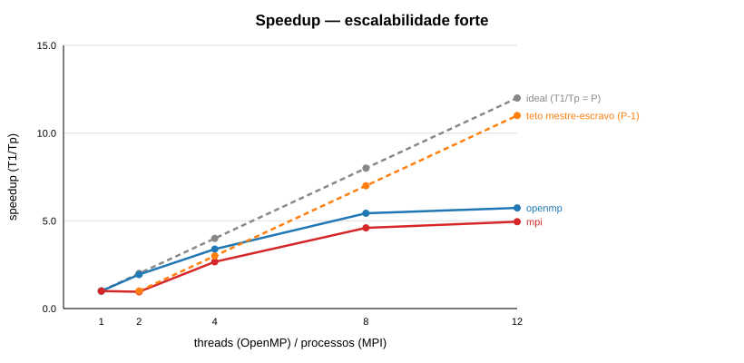

# Busca Exaustiva Paralela — Problema 9

> **Instituição:** Centro Universitário IESB — Campus Asa Sul  
> **Curso:** Ciência da Computação | **Disciplina:** Programação Paralela (`CCO085`) — 2026/2  
> **Docente:** Prof. Rodrigo Gonçalves  
> **Implementações:** Sequencial (baseline original), OpenMP (memória compartilhada) e MPI (memória distribuída — mestre-escravo)

> **Documento de sustentação:** os cálculos de speedup, eficiência, escalabilidade e Lei de Amdahl — com as contas passo a passo — estão em [`docs/ANALISE_EXPERIMENTAL.txt`](docs/ANALISE_EXPERIMENTAL.txt).

---

## Integrantes e Responsabilidades Técnicas

Conforme estabelecido nas diretrizes do projeto (veja também [`AUTORES.md`](AUTORES.md)), a equipe é composta por:

| Integrante | Matrícula | Responsabilidade Técnica |
|---|---|---|
| **Caio Freitas Leandro** | `2422130050` | Baseline, Perfilamento e Versão OpenMP (memória compartilhada) |
| **Rafael Costa Amorim** | `2422130043` | Baseline, Perfilamento e Versão MPI (memória distribuída) |

---

## 1. Descrição do Problema

O código sequencial de referência (`docs/baseline_sequencial.cpp`) realiza uma busca exaustiva sobre um espaço de chaves de tamanho $N = \text{ESPACO}$:

```c
alvo = h(ESPACO / 3);
for (k = 0; k < ESPACO; k++)
    if (h(k) == alvo) { achou = k; break; }
```

O algoritmo calcula o hash de cada chave candidata $k \in [0, \text{ESPACO})$ e **encerra a execução imediatamente ao encontrar a primeira ocorrência** correspondente ao `alvo`. A função de hash utiliza o finalizador de 64 bits do *MurmurHash3*, composto exclusivamente por 3 operações `XOR` e 2 multiplicações em registradores, independentemente do valor de $k$.

Dessa estrutura decorrem duas propriedades fundamentais para a paralelização:

1. **Custo computacional constante por chave ($O(1)$):** Não existe desbalanceamento intrínseco de carga entre diferentes chaves do domínio. Por essa razão, não foi realizado estudo comparativo entre `static`, `dynamic` e `guided`, uma vez que o enunciado condiciona essa análise apenas a problemas com carga desigual.
2. **Bijeção do hash:** Como todas as operações do finalizador são invertíveis em aritmética modular de 64 bits, existe uma única chave válida para cada alvo, localizada exatamente em $k = \lfloor \text{ESPACO} / 3 \rfloor$. A validação de corretude consiste em verificar se as versões paralelas retornam exatamente a mesma chave que o baseline.

O principal desafio algorítmico é o **término antecipado**: caso o espaço de busca fosse particionado em fatias grandes e estáticas por unidade de execução, a thread ou processo responsável pela fatia contendo $\lfloor \text{ESPACO} / 3 \rfloor$ encerraria rapidamente, enquanto os demais permaneceriam processando regiões inúteis. Para mitigar esse desperdício, ambas as versões paralelas adotam a distribuição dinâmica de **blocos pequenos sob demanda**.

---

## 2. Como Compilar e Executar

O ambiente de referência da disciplina é Linux com `g++`, OpenMP e Open MPI.

### Execução Nativa (Linux / Laboratório)

Na raiz do repositório, utilize os alvos do `Makefile`:

```bash
make              # Compila sequencial, openmp e mpi em bin/ com -O2
make validar      # Executa a bateria de testes de corretude contra o baseline
make dados        # Coleta as medições experimentais em dados/bruto.csv e dados/perfilamento.csv
make graficos     # Agrega resultados em dados/resultados.csv e gera os gráficos em graficos/*.svg
```

### Execução via Docker (Windows / Ambientes Isolados)

O projeto inclui um `Dockerfile` configurado com `g++`, Open MPI e Python 3 (os gráficos usam apenas a biblioteca padrão):

```bash
docker build -t pp-busca -f docker/Dockerfile .
docker run --rm -it pp-busca bash
```

Caso deseje montar o diretório local para refletir edições em tempo real dentro do contêiner:

| Terminal | Comando |
|---|---|
| **Linux / macOS** | `docker run --rm -it -v "$(pwd):/projeto" -w /projeto pp-busca bash` |
| **Git Bash (Windows)** | `MSYS_NO_PATHCONV=1 docker run --rm -it -v "$(pwd -W):/projeto" -w /projeto pp-busca bash` |
| **PowerShell (Windows)** | `docker run --rm -it -v "${PWD}:/projeto" -w /projeto pp-busca bash` |
| **CMD (Windows)** | `docker run --rm -it -v "%cd%:/projeto" -w /projeto pp-busca bash` |

### Comandos para Demonstração Direta

```bash
./bin/sequencial 60000000
./bin/openmp 60000000 --threads=8
mpirun -np 8 ./bin/mpi 60000000
```

As três execuções imprimem exatamente a mesma chave encontrada (`20000000`). Nos scripts automatizados, utiliza-se `--use-hwthread-cpus` no `mpirun` para permitir escalar `-np` até o total de CPUs lógicas da máquina.

### Compilando um Arquivo Isolado

Os alvos do `Makefile` já passam todas as flags necessárias. Se for compilar um
arquivo manualmente, duas flags não são opcionais:

```bash
# OpenMP
g++ -O2 -std=c++17 -fopenmp -Isrc src/openmp/openmp.cpp -o bin/openmp

# MPI — o compilador precisa ser o mpicxx (não o g++), e o -Isrc é obrigatório
mpicxx -O2 -std=c++17 -DOMPI_SKIP_MPICXX -Isrc src/mpi/mpi.cpp -o bin/mpi
```

| Erro | Causa |
|---|---|
| `fatal error: mpi.h: No such file or directory` | usou `g++` em vez de `mpicxx`; o `mpi.h` vem do Open MPI, que o `mpicxx` adiciona automaticamente (`mpicxx -show` mostra os caminhos) |
| `fatal error: comum/busca.hpp: No such file or directory` | faltou `-Isrc`; o include é relativo à pasta `src/`, não à pasta do `.cpp` |

Ao compilar de dentro de `src/mpi/`, troque `-Isrc` por `-I..`.

---

## 3. Estrutura do Repositório

```text
├── AUTORES.md                   # Declaração formal dos integrantes e frentes
├── Makefile                     # Automação de compilação, validação, coleta e gráficos
├── README.md                    # Documentação técnica e análise experimental
├── docs/
│   ├── ANALISE_EXPERIMENTAL.txt # Cálculos de speedup, eficiência e Lei de Amdahl (sustentação)
│   ├── Projeto_Academico_PP_20262.pdf  # Enunciado do professor
│   └── baseline_sequencial.cpp  # Código sequencial original fornecido pelo professor (intocado)
├── src/
│   ├── comum/busca.hpp          # Função hash, parsing de argumentos e saída padronizada
│   ├── openmp/openmp.cpp        # Implementação paralela em memória compartilhada (OpenMP)
│   └── mpi/mpi.cpp              # Implementação paralela em memória distribuída (MPI)
├── scripts/
│   ├── validar.sh               # Validação automática de corretude
│   ├── coletar.sh               # Protocolo de benchmarking e perfilamento
│   └── gerar_graficos.py        # Processamento estatístico e geração dos SVGs
├── docker/
│   └── Dockerfile               # Ambiente reprodutível Linux com g++, OpenMPI e Python
├── dados/
│   ├── bruto.csv                # Amostras brutas de todas as repetições
│   ├── perfilamento.csv         # Medições de tempo total vs. laço de busca
│   └── resultados.csv           # Medianas consolidadas de tempo, speedup e eficiência
└── graficos/
    ├── tempo.svg                # Tempo de execução (escalabilidade forte)
    ├── speedup.svg              # Curva de speedup comparada ao limite teórico
    ├── eficiencia.svg           # Eficiência paralela por número de threads/processos
    └── escalabilidade_fraca.svg # Tempo de execução com carga constante por unidade
```

> **Integridade do baseline:** O arquivo `docs/baseline_sequencial.cpp` permanece inalterado e é compilado diretamente pelo `Makefile` com as mesmas flags de otimização (`-O2`) das versões paralelas.

---

## 4. Rastreabilidade dos Requisitos do Projeto

| Requisito do Enunciado | Localização no Repositório |
|---|---|
| Baseline, perfilamento e Lei de Amdahl | Seções 6 e 8; `dados/perfilamento.csv` |
| Versão OpenMP com tratamento de corrida e curva de speedup | `src/openmp/openmp.cpp`; `graficos/speedup.svg` |
| Versão MPI com decomposição, coletivas e curva de speedup | `src/mpi/mpi.cpp`; `docs/ANALISE_EXPERIMENTAL.txt` (seção 7) |
| Validação de corretude contra o gabarito sequencial | `scripts/validar.sh` (`make validar`) |
| Gráficos de tempo, speedup, eficiência e escalabilidade | `graficos/*.svg` (`make graficos`) |
| Análise de escalabilidade fraca | Seção 7; `graficos/escalabilidade_fraca.svg` |
| Discussão do afastamento em relação à Lei de Amdahl | Seção 8 |
| `Makefile`, CSVs, `README.md`, gráficos e `AUTORES.md` | Raiz e diretórios dedicados do repositório |

---

## 5. Decisões de Implementação

### OpenMP (`src/openmp/openmp.cpp`)

* **Granularidade e escalonamento:** O espaço de busca é dividido em blocos de `16.384` chaves distribuídos via `#pragma omp parallel for schedule(dynamic, 1)`. Dessa forma, todas as threads avançam de maneira sincronizada no espaço de busca e, quando a chave é encontrada, o trabalho excedente fica limitado a no máximo um bloco por thread.
* **Controle de condição de corrida:** Uma flag compartilhada `std::atomic<bool> parar{false}` sinaliza o término antecipado. Uma thread escreve `true` ao localizar o alvo e as demais verificam a flag no início de cada bloco, evitando leitura/escrita concorrente não sincronizada (*data race*) sem o custo de uma região crítica dentro do laço.
* **Consolidação do resultado:** Cada thread mantém sua melhor chave local em variável privada de pilha e atualiza a variável global uma única vez ao sair da região paralela, protegida por `#pragma omp critical`.
* **Descarte de `reduction(min:)` e ausência de *false sharing*:** A cláusula `reduction` exige o percurso completo das iterações do laço, sendo incompatível com o encerramento antecipado (`break`). Como nenhuma thread escreve em posições adjacentes de memória compartilhada durante a busca, não ocorre *false sharing*.

### MPI (`src/mpi/mpi.cpp`)

* **Decomposição mestre-escravo:** Conforme destacado na especificação do Problema 9, o processo de rank `0` atua como **mestre** (coordenador) e os ranks $1 \dots P-1$ atuam como **escravos** (trabalhadores). O mestre distribui intervalos `[início, fim)` sob demanda; os escravos retornam mensagens com tag `PEDIDO` (ao concluir um bloco sem sucesso) ou `RESULTADO` (ao encontrar o alvo), momento em que o mestre difunde a tag `PARAR` aos demais.
* **Operações coletivas:** Utiliza-se `MPI_Bcast` no início da execução para difundir os parâmetros da busca (`espaco`, `alvo` e `bloco`) e `MPI_Allreduce(..., MPI_MIN, ...)` ao final para consolidar globalmente a menor chave encontrada. O operador `MPI_MIN` assegura determinismo idêntico ao baseline sequencial, independentemente da ordem de chegada das mensagens assíncronas.
* **Teto teórico:** Como o rank `0` dedica-se exclusivamente à coordenação, apenas $P - 1$ processos realizam cálculos de hash, impondo um teto teórico de eficiência igual a $\frac{P - 1}{P}$. O detalhamento dessa escolha está documentado em [`docs/ANALISE_EXPERIMENTAL.txt`](docs/ANALISE_EXPERIMENTAL.txt) (seções 4.9 e 7).

---

## 6. Metodologia Experimental e Perfilamento

* **Protocolo de medição:** Foram realizadas 3 execuções de aquecimento do baseline antes da bateria de testes, além de 1 execução de aquecimento descartada por configuração, seguidas de **5 repetições válidas** por ponto experimental. Os gráficos e tabelas reportam a **mediana** das amostras.
* **Métrica de tempo:** Registra-se exclusivamente o intervalo da região de busca (`tempo_busca`), garantindo equivalência direta com o tempo instrumentado no baseline original.
* **Definição de Speedup:** Calculado como $S(P) = \frac{T_1}{T_P}$ em relação à execução com 1 unidade da própria versão paralela.
* **Escalabilidade fraca:** O tamanho do problema escala proporcionalmente à capacidade de processamento: $\text{ESPACO} = \text{base} \times P$ no OpenMP e $\text{ESPACO} = \text{base} \times (P - 1)$ no MPI (compensando o processo mestre dedicado à coordenação).

### Perfilamento e Lei de Amdahl

O perfilamento foi conduzido sem alterar o código do baseline, comparando o tempo total de processo (`date +%s%N`) com o tempo interno do laço reportado pelo programa (`dados/perfilamento.csv`):

| $\text{ESPACO}$ | Tempo Total (s) | Tempo do Laço (s) | Fração no Laço (%) |
|---:|---:|---:|---:|
| `60.000.000` | `0,020413` | `0,016745` | `82,0%` |
| `480.000.000` | `0,137794` | `0,133333` | `96,8%` |
| `4.800.000.000` | `1,339528` | `1,346270` | `~100,0%` |

Para entradas de grande porte ($\text{ESPACO} = 4,8 \times 10^9$), praticamente $100\%$ do tempo de execução concentra-se no laço de avaliação do hash (variações de poucos milissegundos situam-se dentro da margem de ruído do escalonador do sistema operacional). Assim, a fração paralelizável é $p \approx 1$ e, pela Lei de Amdahl:

$$S(P) = \frac{1}{(1 - p) + \frac{p}{P}} \approx P \quad (\text{para } p \approx 1)$$

A reta ideal $S(P) = P$ representa, portanto, o limite superior teórico; qualquer desvio observado nos experimentos decorre de fatores arquiteturais e de sincronização analisados na Seção 8.

---

## 7. Resultados Experimentais

Os valores abaixo correspondem às medianas de 5 repetições extraídas de `dados/resultados.csv` (com $\text{ESPACO} = 4,8 \times 10^9$ na escalabilidade forte).

### Escalabilidade Forte

| Configuração | Tempo (s) | Speedup ($S$) | Eficiência ($E$) |
|---|---:|---:|---:|
| Sequencial (baseline) | `1,356594` | `1,00` | — |
| OpenMP — 1 thread | `1,352755` | `1,00` | `100,0%` |
| OpenMP — 2 threads | `0,697000` | `1,94` | `97,0%` |
| OpenMP — 4 threads | `0,399368` | `3,39` | `84,7%` |
| OpenMP — 8 threads | `0,249195` | `5,43` | `67,9%` |
| OpenMP — 12 threads | `0,235784` | `5,74` | `47,8%` |
| MPI — 1 processo | `1,348921` | `1,00` | `100,0%` |
| MPI — 2 processos | `1,413248` | `0,95` | `47,7%` |
| MPI — 4 processos | `0,506794` | `2,66` | `66,5%` |
| MPI — 8 processos | `0,293373` | `4,60` | `57,5%` |
| MPI — 12 processos | `0,272404` | `4,95` | `41,3%` |

Na versão MPI, o volume de troca de mensagens ponto a ponto escalou de **87 mensagens** ($P = 2$) para **259** ($P = 4$), **607** ($P = 8$) e **945 mensagens** ($P = 12$). Com $P = 2$, o modelo mestre-escravo apresenta desempenho inferior ao sequencial ($S = 0,95\times$), pois apenas um processo realiza a busca enquanto o segundo atua exclusivamente como coordenador, adicionando latência de comunicação sem ganho de paralelismo. Com $P = 12$, o teto teórico de eficiência é $\frac{11}{12} \approx 91,7\%$; a eficiência medida de $41,3\%$ reflete o compartilhamento de núcleos físicos via SMT (*Simultaneous Multithreading*) e a latência de propagação da parada antecipada.





### Escalabilidade Fraca

| Unidades de Execução | OpenMP (s) | MPI (s) |
|---:|---:|---:|
| `1` | `0,133991` | `0,134367` |
| `2` | `0,142154` | `0,134607` |
| `4` | `0,145182` | `0,143270` |
| `8` | `0,198414` | `0,199313` |
| `12` | `0,276910` | `0,276691` |

Em um cenário ideal de escalabilidade fraca, o tempo de execução permaneceria constante à medida que a carga cresce proporcionalmente ao número de unidades. O aumento observado a partir de 8 e 12 unidades ocorre de forma quase idêntica tanto em OpenMP quanto em MPI, evidenciando que o gargalo não reside na sincronização ou na troca de mensagens, mas nas restrições físicas do processador (redução de *boost clock* sob carga *all-core* e contenção de recursos internos entre threads de hardware/SMT).


---

## 8. Análise do Afastamento em Relação à Lei de Amdahl

1. **Subutilização estrutural no padrão mestre-escravo (MPI):** Com $P$ processos, apenas $P - 1$ executam trabalho útil de busca. Isso limita o speedup máximo teórico a $S(P) \le P - 1$ e a eficiência máxima a $\frac{P - 1}{P}$.
2. **Overhead de comunicação e serialização no mestre:** Cada bloco requisitado exige um par de mensagens (`PEDIDO` e `BLOCO`). Conforme $P$ cresce, o volume de mensagens aumenta e o processo mestre torna-se um ponto central de serialização, além de introduzir latência até que todos os escravos recebam o sinal `PARAR`.
3. **Desbalanceamento residual por término antecipado:** Embora o particionamento dinâmico em blocos de `16.384` chaves reduza drasticamente o desbalanceamento em comparação a fatias estáticas, ainda há uma fração residual de trabalho descartado nos blocos em andamento no instante em que o alvo é encontrado.
4. **Ausência de *false sharing*:** Como cada thread acumula resultados em variáveis privadas de pilha, consulta apenas uma flag atômica (`parar`) e realiza uma única escrita crítica ao término, não há invalidação cruzada de linhas de cache L1/L2 entre núcleos.
5. **Ausência de saturação de banda de memória:** O cálculo do hash opera integralmente sobre registradores da CPU, sem varreduras sequenciais ou aleatórias em vetores na RAM. Diferentemente de problemas *memory-bound* (como multiplicação de matrizes ou convolução 2D), o limite aqui é puramente computacional (*compute-bound*).
6. **Escalonamento de frequência e SMT do hardware:** A ativação simultânea de todos os núcleos físicos e lógicos provoca redução térmica/energética da frequência de operação (*clock*) e competição pelas unidades funcionais internas dos núcleos físicos, explicando a perda de eficiência observada tanto na escalabilidade forte quanto na fraca.

---

## 9. Resumo das Justificativas Técnicas

* **Por que não houve comparação entre `static`, `dynamic` e `guided`?**  
  O custo computacional de `hash_chave(k)` é determinístico e constante para qualquer $k$, sem ramificações dependentes de dados ou acessos irregulares à memória. Como o enunciado solicita o comparativo de políticas de escalonamento apenas para problemas com carga desigual, adotou-se `schedule(dynamic, 1)` sobre blocos fixos exclusivamente para viabilizar o término antecipado equilibrado.
* **Como a condição de corrida foi tratada no OpenMP?**  
  A sinalização de parada utiliza `std::atomic<bool> parar` para garantir visibilidade imediata entre threads sem *data race*, enquanto a atualização do menor índice encontrado ocorre uma única vez por thread fora do laço principal mediante `#pragma omp critical`.
* **Quais operações coletivas foram empregadas no MPI e por quê?**  
  `MPI_Bcast` distribui os parâmetros iniciais da busca a partir do rank `0` e `MPI_Allreduce` com operador `MPI_MIN` garante que todos os processos obtenham a menor chave válida, preservando a semântica de primeira ocorrência do baseline sequencial.
* **Como a corretude é comprovada?**  
  O script `scripts/validar.sh` (`make validar`) confronta automaticamente a saída de `./bin/openmp` e `./bin/mpi` contra `./bin/sequencial` em múltiplos tamanhos de entrada (incluindo casos de borda como `0`, `1`, `2` e `3`) e diferentes contagens de threads e processos.